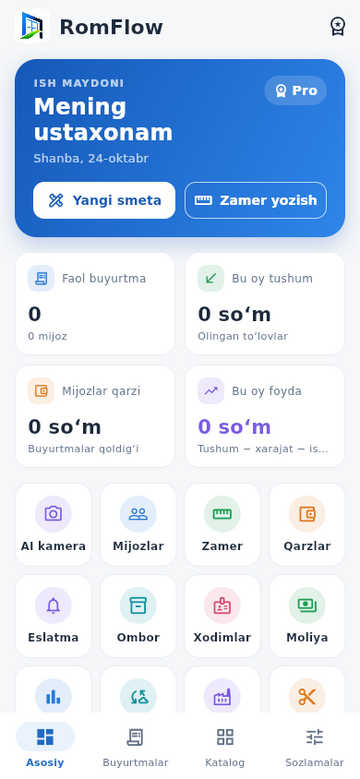
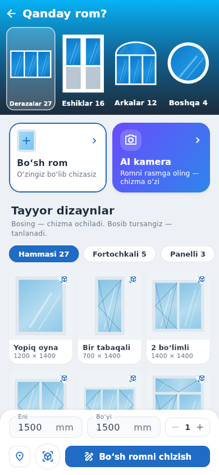
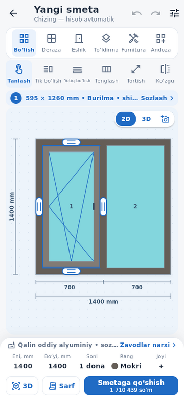
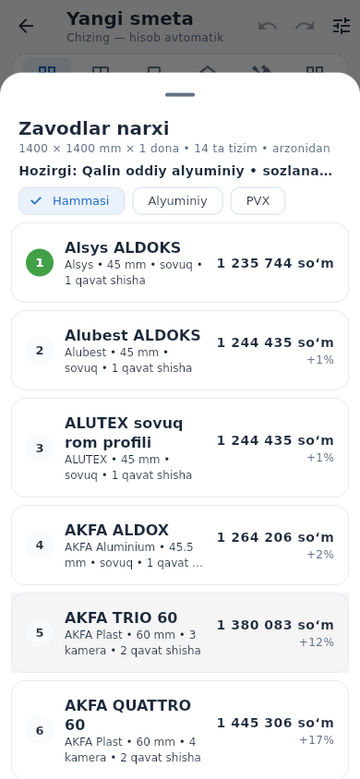
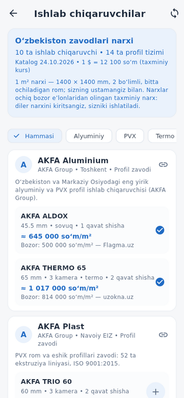
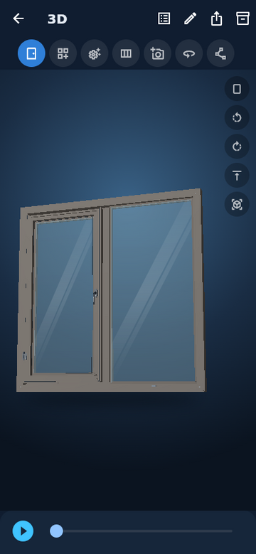

# RomFlow

**Eshik va rom ustaxonalari uchun smeta, chizma, 3D va buyurtmalar.**
Android, iPhone/iPad, Windows, macOS va Linux. Internetsiz ishlaydi: login,
server va reklama yo‘q — hamma ma’lumot telefonning o‘zida.

<p>






</p>

## Imkoniyatlar
- **Chizma stoli.** 59 ta tayyor dizayn (deraza, eshik, arka, boshqa shakllar)
  yoki bo‘sh rom. Bo‘limlarni bo‘lish, sudrab qo‘yish, chetidan tortib
  o‘lchamini o‘zgartirish, zinapoya rama (ikki yoni devorli eshik, balkon
  bloki), ochilish turlari, shisha/panel/lambir, furnitura.
- **Zavodlar narxi.** O‘zbekistondagi 10 ta ishlab chiqaruvchi (AKFA,
  ENGELBERG, IMZO, Alubest, ALUTEX…) va 14 ta profil tizimi. Bir bosishda shu
  rom barcha tizimlarda hisoblanib, arzonidan qimmatiga tartiblanadi.
  Batafsil: [docs/NARXLAR-UZ.md](docs/NARXLAR-UZ.md).
- **Aniq sarf hisobi.** Profil, shisha, rezina, furnitura, montaj
  materiallari; raskroy (tayoq va list bo‘yicha), chiqindi, rang ustamasi.
- **3D.** Jonli 3D model, ochilish animatsiyasi, detallarni sochish/yig‘ish,
  profil kesimlari.
- **AI kamera va “Joyida”.** Romni rasmga olib chizma yaratish (telefonda yoki
  o‘z Claude kalitingiz bilan); jonli kamerada rom haqiqiy darchaga qo‘yiladi.
- **Buyurtmalar.** Smeta → PDF → buyurtma bosqichlari, to‘lovlar, qarzlar,
  bo‘lib to‘lash, razmer, eslatmalar, ombor, xodimlar va ish haqi, moliya.
- **Narxlar.** Markaziy bankning dollar kursi har kuni; dollardagi narxlar
  kursga ergashadi. Diler yoki Google Sheets jadvalidan narx yuklash.

Yangiliklar: [docs/YANGILIKLAR-UZ.md](docs/YANGILIKLAR-UZ.md) •
Tez boshlash: [docs/OFFLINE-UZ.md](docs/OFFLINE-UZ.md) •
Chizma va 3D qo‘llanmasi: [docs/CHIZMA-UZ.md](docs/CHIZMA-UZ.md)

## Yuklab olish
**Releases** bo‘limidan:
- `RomFlow-…-arm64.apk` — ko‘pchilik Android telefonlar (Android 7+);
- `RomFlow-…-armv7.apk` — eski telefonlar; `RomFlow-….apk` — hammasiga;
- `…-windows-x64.zip`, `…-linux-x64.tar.gz`, `…-macos.zip`;
- **iPhone / iPad (iOS 15 – 27)**: TestFlight havolasidan bir bosishda yoki
  bepul SideStore orqali — aniq qo‘llanma: [docs/IPHONE-UZ.md](docs/IPHONE-UZ.md).

Yangi APK eskisining ustiga o‘rnatiladi, ma’lumotlar saqlanadi (bir xil imzo
bilan). Yangilashdan oldin Sozlamalar → Zaxira nusxa saqlash tavsiya etiladi.

## Narxlar haqida
Zavodlar katalogidagi narxlar ochiq bozor e’lonlariga moslangan **taxminiy**
narx: O‘zbekistonda zavod prayslari uchun ochiq API yo‘q. O‘z dileringiz
narxini kiriting yoki jadvaldan yuklang — sizniki ishlatiladi va katalog
yangilanganda ham o‘zgarmaydi. Smeta natijasini sex ustasi tekshirsin.

## Maxfiylik
Mijozlar, narxlar, smetalar va to‘lovlar faqat qurilmada saqlanadi. Internet
faqat dollar kursi, zavodlar katalogi, siz qo‘shgan narx havolalari va
(kalitingiz bo‘lsa) AI kamera uchun ishlatiladi. Batafsil:
[docs/MAXFIYLIK-UZ.md](docs/MAXFIYLIK-UZ.md).

## Dasturchilar uchun
Flutter 3.35.7 (stable), Dart 3.9, Java 17.
```bash
flutter pub get
flutter analyze
flutter test
flutter build apk --release        # yoki: linux, windows, macos, ios --no-codesign
```

| Fayl | Vazifasi |
|---|---|
| `lib/design_engine.dart` | Chizma geometriyasi, sarf va narx hisobi, raskroy |
| `lib/drawing_ui.dart` | Chizma stoli |
| `lib/drawing_3d.dart` | 3D model va render |
| `lib/design_catalog.dart` | Tayyor dizaynlar katalogi |
| `lib/manufacturers.dart`, `lib/manufacturers_page.dart` | Zavodlar katalogi va narx solishtirish |
| `assets/manufacturers_uz.json` | Zavodlar, tizimlar va narxlar (ilovalar shu fayldan yangilanadi) |
| `lib/store.dart` | Qurilmadagi ma’lumotlar, zaxira, narxlar |
| `lib/exchange_rate.dart`, `lib/price_sources.dart` | Dollar kursi va narx manbalari |
| `lib/window_photo.dart`, `lib/ai_vision.dart`, `lib/in_place_page.dart` | AI kamera va “Joyida” |
| `integration_test/demo_test.dart` | Emulyatorda yoziladigan demo video ssenariysi |

GitHub Actions har bir push’da tahlil va testlarni ishga tushiradi, Android,
Windows, Linux, macOS va iOS yig‘malarini quradi, Android emulyatorida
o‘rnatib ochadi va demo videoni yozadi.

### Android imzosi
Release imzo kaliti repoga qo‘yilmaydi. Mahalliy yig‘ish uchun
`android/key.properties` yarating (u `.gitignore`da):
```properties
storeFile=upload.keystore
storePassword=…
keyAlias=…
keyPassword=…
```
`storeFile` — `android/app/` ga nisbatan yo‘l. CI uchun repo secret’lari:
`ROMFLOW_KEYSTORE_BASE64` (keystore fayli base64’da), `ROMFLOW_KEYSTORE_PASSWORD`,
`ROMFLOW_KEY_ALIAS`, `ROMFLOW_KEY_PASSWORD`. Secret bo‘lmasa APK Android
debug kaliti bilan imzolanadi — u sinov uchun, oldingi APK ustiga o‘rnatilmaydi.
Google Play va App Store: [docs/PUBLISH-UZ.md](docs/PUBLISH-UZ.md).

## Hissa qo‘shish
Xato topsangiz yoki narx eskirgan bo‘lsa — Issue oching. Kod va narx
o‘zgarishlari uchun: [CONTRIBUTING.md](CONTRIBUTING.md). Xavfsizlik:
[SECURITY.md](SECURITY.md).

## Litsenziya
[LICENSE](LICENSE). Shrift (DejaVu Sans) va ikonka (Tabler Icons) o‘z
litsenziyalari bilan: `assets/FONT-LICENSE.txt`, `assets/TABLER-ICONS-LICENSE.txt`.

---

### English
RomFlow is an offline estimating and order app for window and door workshops
in Uzbekistan (UI in Uzbek). It draws windows, doors and arches, computes the
bill of materials and cutting plans, shows a 3D model, prices one design
across 14 profile systems from 10 Uzbek manufacturers (AKFA, ENGELBERG,
Alubest, …), and keeps customers, orders and payments on the device. Built
with Flutter for Android, iOS, Windows, macOS and Linux. Catalog prices are
estimates matched to public listings; see `docs/NARXLAR-UZ.md`.
